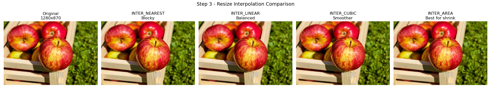

# Fruit Counting and Instance Detection
### Visual Computing and Image Processing — 25CSAI02I
**The British University in Egypt | Faculty of Informatics and Computer Science**
**Module Leader: Dr. Ahmed Fahmi | Semester Two | 2025–2026**

---

## Project Overview

This group coursework project contains image processing and YOLO training notebooks, plus a Streamlit interface for fruit counting and detection. The group is split into two subteams, each working on a different dataset and training different YOLO versions for cross-model comparison.

| | Subteam A | Subteam B |
|---|---|---|
| Dataset | fruit-detection-2aajq/fruit-nxoac (825 images) | fruitsdetection/fruits-by-yolo (1,176 images) |
| Classes | Apple, Tomato, Cauliflower, Adrak, Bitter Gourd, Capsicum | Apple, Banana, Grapes, Mango, Orange, Strawberry |
| Models | YOLOv5 and YOLOv8 | YOLOv9 and YOLOv10 |

---

## Project Files

```
project/
├── Preprocessing.ipynb       ← Image preprocessing pipeline (Subteam A)
├── Augmentation.ipynb        ← Data augmentation study (Subteam A)
├── Training.ipynb            ← YOLO model training — YOLOv5 and YOLOv8 (Subteam A)
├── app.py                    ← Streamlit web application (full group)
├── yolov5.pt                 ← Trained YOLOv5 weights (add after training)
├── yolov8.pt                 ← Trained YOLOv8 weights (add after training)
├── yolov9.pt                 ← Trained YOLOv9 weights (add after Subteam B trains)
└── yolov10.pt                ← Trained YOLOv10 weights (add after Subteam B trains)
```

> **Note:** The `.pt` weight files are not included in this repository. They are generated after running `Training.ipynb` and must be placed in the same folder as `app.py` before running the Streamlit app.

---

## File Descriptions

### 1. Preprocessing.ipynb
Applies and compares all required preprocessing steps on a sample image from the Subteam A dataset.

**Steps covered:**
- Step 1 — Load sample image from Roboflow dataset
- Step 2 — Color space conversion: BGR → RGB and Grayscale
- Step 3 — Resize to 640×640 with aspect ratio preserved (4 interpolation methods compared: INTER_NEAREST, INTER_LINEAR, INTER_CUBIC, INTER_AREA)
- Step 4 — Noise reduction (Mean, Gaussian, Median, Bilateral — side-by-side comparison)
- Step 5 — Thresholding and binarization (Simple, Adaptive, Otsu's method)
- Step 6 — Histogram visualization (grayscale + RGB channels)
- Step 7 — Sharpening filter using a 3×3 convolution kernel

**Output figures saved:**
```
step2_color_space.png
step3_resizing.png
step4_translation.png
step5_noise_reduction.png
step6_thresholding.png
step7_histogram.png
step8_sharpening.png
```

---

### 2. Augmentation.ipynb
Implements and compares all 6 required augmentation techniques with before-and-after figures for the project report.

**Augmentations covered:**

| # | Technique | Key Function |
|---|---|---|
| 1 | Translation | `cv2.warpAffine()` with translation matrix |
| 2 | Rotation | `cv2.getRotationMatrix2D()` + `cv2.warpAffine()` |
| 3 | Flipping | `cv2.flip()` — horizontal (1), vertical (0), both (-1) |
| 4 | Cropping | NumPy array slicing `[y1:y2, x1:x2]` |
| 5 | Brightness and Contrast | `cv2.convertScaleAbs(alpha, beta)` |
| 6 | Gamma Correction | `cv2.LUT()` with lookup table |

**Output figures saved:**
```
aug1_translation.png
aug2_rotation.png
aug3_flipping.png
aug4_cropping.png
aug5_brightness_contrast.png
aug6_gamma.png
aug_all_summary.png
```

---

### 3. Training.ipynb
Trains YOLOv5 and YOLOv8 on the Subteam A dataset using transfer learning from COCO pretrained weights.

**Pipeline 1 — YOLOv5:**
- Model: `yolov5n.pt`
- Epochs: 50
- Image size: 640×640
- Batch size: 16
- Early stopping: patience = 10

**Pipeline 2 — YOLOv8:**
- Model: `yolov8n.pt`
- Epochs: 50
- Image size: 640×640
- Batch size: 8
- Early stopping: patience = 10

**Steps covered:**
- Download dataset from Roboflow (requires API key)
- Create and verify `data.yaml` configuration
- Train YOLOv5 and YOLOv8
- Run predictions on 3 test images
- Side-by-side model comparison figure
- Confidence threshold effects (0.25, 0.50, 0.75)
- Validation metrics table (mAP@0.5, mAP@0.5:0.95, Precision, Recall)
- Display training loss and mAP curves

**Output files saved:**
```
pred_v5_0.jpg / pred_v5_1.jpg / pred_v5_2.jpg
pred_v8_0.jpg / pred_v8_1.jpg / pred_v8_2.jpg
comparison_v5_vs_v8.png
confidence_threshold_effects.png
runs/detect/fruit_yolov5/weights/best.pt   ← best YOLOv5 weights
runs/detect/fruit_yolov8/weights/best.pt   ← best YOLOv8 weights
runs/detect/fruit_yolov5/results.png       ← training curves
runs/detect/fruit_yolov8/results.png       ← training curves
```

---

### 4. app.py
Streamlit web application that runs inference using all 4 trained models and visualizes results interactively.

**Pages:**

| Page | Description |
|---|---|
| Home | Project overview, subteam info, dataset details |
| Single Model Detection | Upload an image, choose a model, see bounding boxes and confidence scores |
| Multi-Model Comparison | Upload one image and compare all 4 models side by side in a 2×2 grid |
| Model Metrics | Metrics table, F1 score, and bar charts for mAP, Precision, and Recall |

**Sidebar controls:**
- Page navigation dropdown
- Model selector (yolov5.pt, yolov8.pt, yolov9.pt, yolov10.pt)
- Confidence threshold slider (0.01 – 1.00, default 0.25)

---

## Setup and Installation

### Step 1 — Create Anaconda environment
```
conda create -n FruitDetection python=3.12.3
conda activate FruitDetection
```

### Step 2 — Install required libraries
```
python -m pip install ultralytics roboflow torch torchvision streamlit Pillow opencv-python matplotlib numpy jupyter
```

### Step 3 — Run the notebooks in order
```
1. Preprocessing.ipynb
2. Augmentation.ipynb
3. Training.ipynb          ← requires Roboflow API key
```

### Step 4 — Rename trained weights for the Streamlit app
After Training.ipynb completes, copy and rename the best weights:
```
runs/detect/fruit_yolov5/weights/best.pt  →  yolov5.pt
runs/detect/fruit_yolov8/weights/best.pt  →  yolov8.pt
```
Place both `.pt` files in the same folder as `app.py`.

### Step 5 — Run the Streamlit app
```
streamlit run app.py
```
The browser opens automatically at `http://localhost:8501`

---

## Roboflow API Key

The training notebook requires a Roboflow API key to download the dataset. To get yours:
1. Go to https://app.roboflow.com
2. Create a free account
3. Go to **Settings → API Keys**
4. Copy your **Private API Key**
5. Configure the empty API-key argument in `Training.ipynb` Step 2 locally. Do not commit a populated private key.

---

## Model Performance Results

| Metric | YOLOv5 | YOLOv8 | YOLOv9 | YOLOv10 |
|---|---|---|---|---|
| mAP@0.5 | **0.989** | 0.988 | 0.740 | 0.709 |
| mAP@0.5:0.95 | **0.900** | 0.885 | 0.614 | 0.567 |
| Precision | 0.988 | **0.989** | 0.707 | 0.739 |
| Recall | **0.996** | **0.996** | 0.706 | 0.660 |

> These are reported validation results, also recorded as constants in the app. The committed training notebook has no saved execution outputs, so the table is not independently reproducible from stored outputs alone. Subteams used different datasets and class sets: these scores do not establish an overall ranking of YOLO architectures or explain the cause of performance differences.

---

## Dependencies

| Library | Version | Purpose |
|---|---|---|
| ultralytics | latest | YOLO model training and inference |
| roboflow | latest | Dataset download |
| torch | latest | Deep learning backend |
| opencv-python | latest | Image processing |
| streamlit | latest | Web application |
| Pillow | latest | Image loading in Streamlit |
| matplotlib | latest | Figure generation in notebooks |
| numpy | latest | Array operations |

## Image processing example

The following committed figure illustrates preprocessing, rather than trained-model detection:



## Reproducibility and current limitations

- Trained weights are not included. Detection requires the appropriate trained weights; the repository does not currently provide a ready-to-run pretrained demo.
- The included training notebook covers Subteam A only. Subteam B weights and training provenance must be obtained separately for those app options.
- Dependency versions in the table above are unpinned. The setup has not been validated in a clean environment; `latest` is not a reproducibility guarantee.
- The training notebook evaluates through `model.val(data=yamlPath)` without explicitly selecting the test split. Do not describe the reported validation scores as held-out test results.
- The app's metrics page displays stored values; it does not evaluate an uploaded image against ground-truth labels.
- A fair architecture comparison needs a shared dataset, class definitions, evaluation split, and documented training settings.
- This is group coursework. Individual contributions have not yet been itemized here.

## Next development steps

- Publish evaluation logs, split sizes, class-level metrics, and failure examples.
- Verify setup and record tested dependency versions.
- Provide permitted model downloads with provenance and a sample input.
- Add image validation and tests for inference helpers.
